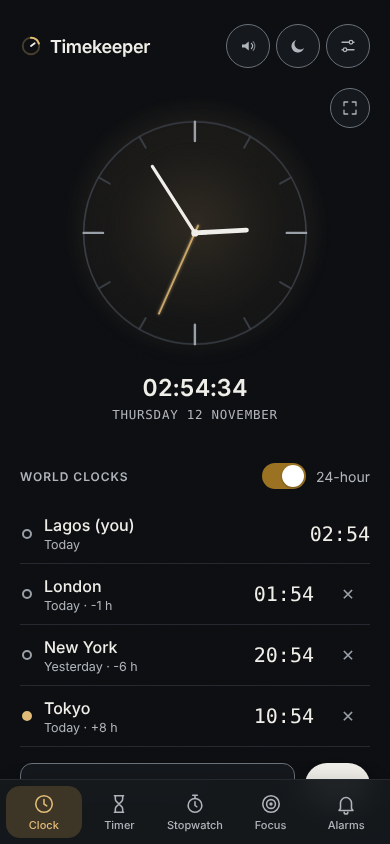

<p align="center">
  
</p>

<h1 align="center">Timekeeper</h1>

<p align="center">A clock, world clocks, timer, stopwatch, focus timer, and alarms in one quiet instrument.</p>

<p align="center">
  <a href="https://github.com/babatundeawo/timekeeper/actions/workflows/deploy.yml"></a>
  <a href="https://github.com/babatundeawo/timekeeper/actions/workflows/codeql.yml"></a>
</p>

<p align="center">
  <a href="https://babatundeawo.github.io/timekeeper/">Live site</a> ·
  <a href="docs/CUSTOMIZING.md">Documentation</a> ·
  <a href="https://github.com/babatundeawo/timekeeper/issues">Report an issue</a>
</p>

<p align="center">
  
</p>

## About

Timekeeper puts the time tools you reach for every day behind one calm interface. It runs entirely in your browser, stores nothing on a server, and works offline once installed. Every mode shares one brass ring that sweeps, fills, or empties to show progress.

## Features

- **Clock**: analog face with a digital readout and date, plus world clocks for up to 12 time zones with day and night markers, the date difference and the hour offset from you.
- **Timer**: quick-start chips, manual hours, minutes and seconds, saved custom presets, a +1:00 button while running, and an "until a time" mode that counts down to a time of day. A timer can be shared as a link.
- **Stopwatch**: start, pause, reset and lap recording with hundredths of a second, fastest and slowest lap markers, and a copy-laps button.
- **Focus**: Pomodoro cycles with adjustable focus, short break, long break and round count, an optional task name, optional brown noise or rain while you work, and automatic or manual phase changes.
- **Focus history**: today's minutes, sessions, a day streak and a seven-day chart, saved on your device and exportable as CSV.
- **Alarms**: time, label, repeat days, a choice of four tones, and snooze (5, 10 or 15 minutes) that survives a reload. A ringing alarm takes over the screen.
- Timers and the stopwatch keep their place if you close the page and come back. A countdown that finished while the page was closed tells you so.
- Optional notifications, screen kept awake while a timer runs, vibration, volume control, full screen, keyboard shortcuts, light and dark themes that follow your system.
- Installable as an app on Android, iPhone and desktop, with an update prompt that never traps you on an old version.

All data stays in your browser on your device.

## How to use it

1. Open the [live site](https://babatundeawo.github.io/timekeeper/) and pick a mode from the tabs.
2. Press **Start** on Timer, Stopwatch or Focus. On a keyboard, `Space` starts or pauses, `R` resets, `L` records a lap, `F` toggles full screen, `M` mutes, `,` opens settings, and `1` to `5` switch modes. Arrow keys move between tabs.
3. To install, use your browser's install option, or the Install button in Settings. On iPhone, open the site in Safari and choose Share, then Add to Home Screen.

Alarms ring only while Timekeeper is open in a browser tab or the installed window. The site has no server, so it cannot wake a closed app.

## Tech stack

- Plain HTML, CSS and JavaScript modules with no runtime dependencies
- Self-hosted Geist and Geist Mono (fetched from Fontsource during the build)
- Web Audio, Screen Wake Lock, Notifications and Service Worker APIs
- GitHub Actions and GitHub Pages for checks and hosting

## Project structure

```
site/                  The website exactly as it is served
├── index.html         Page markup and metadata
├── css/style.css      Design tokens and styles
├── js/main.js         Entry point: modes, shortcuts and full screen
├── js/core.js         Storage, settings, shared tick loop, wake lock
├── js/audio.js        Synthesized alarm tones and background noise
├── js/stage.js        The shared ring and readout
├── js/clock.js        Analog clock and world clocks
├── js/countdown.js    Timer
├── js/stopwatch.js    Stopwatch and laps
├── js/focus.js        Pomodoro focus timer
├── js/stats.js        Focus history and CSV export
├── js/alarms.js       Alarms and snooze
├── js/pwa.js          Install prompt, update prompt and offline notice
├── js/settings-ui.js  Settings dialog
├── js/theme.js        Theme choice
├── js/theme-init.js   Applies the saved theme before first paint
├── offline.html       Page shown when offline and not yet cached
├── 404.html           Page shown for unknown addresses
├── service-worker.js  Offline caching and update flow
├── manifest.json      Web app manifest
├── icons/             Favicon, app icons and social preview image
└── screenshots/       Screenshots shown in the install prompt
scripts/               Local server, site checks, browser test, screenshot tool
docs/                  Guides for maintaining the site
.github/workflows/     Deployment, checks and CodeQL
```

## Contributing

Bug reports and ideas are welcome through [GitHub issues](https://github.com/babatundeawo/timekeeper/issues). See [CONTRIBUTING.md](CONTRIBUTING.md) for how to run the checks and propose a change.

## Security

Report vulnerabilities privately as described in [SECURITY.md](SECURITY.md). The site sets a strict Content Security Policy through a meta tag. GitHub Pages cannot send custom HTTP headers, so protections that need headers are not available.

## Credits

Typefaces: [Geist and Geist Mono](https://vercel.com/font) by Vercel, licensed under the SIL Open Font License 1.1. Icons, sounds and the logo are drawn or synthesized for this project.

Maintainer guides: [Deployment](docs/DEPLOYMENT.md) · [Customizing](docs/CUSTOMIZING.md)
